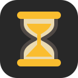
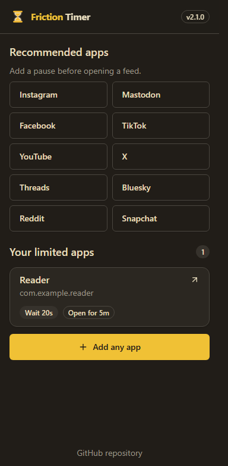
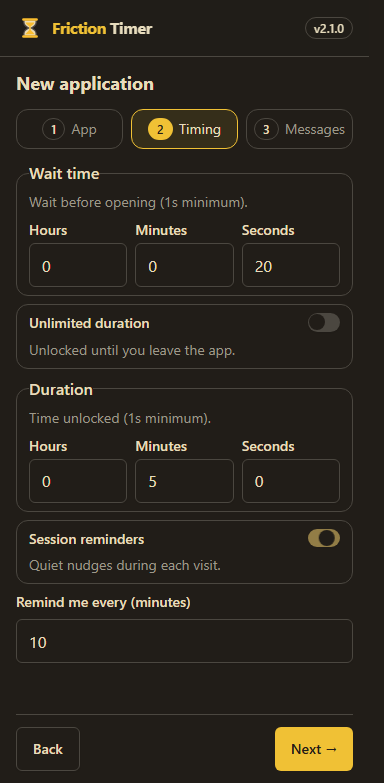

  
  <h1>Friction Timer</h1>
  
A moment to think before you open an app. A reminder when you keep scrolling.

  
  
  
  

  <a href="https://github.com/Today20092/FrictionTimer/releases/latest/download/FrictionTimer-arm64.apk"><strong>Download the latest APK</strong></a> ·
  <a href="https://apps.obtainium.imranr.dev/redirect?r=obtainium://app/%7B%22id%22%3A%22com.brunorochamoura.frictiontimer%22%2C%22url%22%3A%22https%3A%2F%2Fgithub.com%2FToday20092%2FFrictionTimer%22%2C%22author%22%3A%22Today20092%22%2C%22name%22%3A%22Friction%20Timer%22%7D">Add to Obtainium</a> ·
  <a href="docs/usage.md">Usage guide</a> ·
  <a href="docs/releases/v2.2.0.md">What's new</a> ·
  <a href="docs/development.md">Development</a> ·
  <a href="https://github.com/Today20092/FrictionTimer/issues">Report a problem</a>

Friction Timer adds a waiting overlay before selected Android apps open. Wait and proceed, or cancel and put the phone down. You choose the wait, messages, and how soon another pause is needed for each app.

## Get started

1. Download the [latest signed ARM64 APK](https://github.com/Today20092/FrictionTimer/releases/latest/download/FrictionTimer-arm64.apk) and allow your browser or file manager to install it.
2. Enable **Display over other apps** and Friction Timer's **Accessibility service**.
3. Pick a recommended app, or choose **Add any app**. Set your wait and messages, then save.
4. Optionally enable session reminders and notification permission. The initial interval is **10 minutes**, and you can change it per app.

The published APK supports Android 7+ on ARM64 devices. It uses this fork's signing key; an upstream or development build signed with another key cannot be updated in place. See [installation and updates](docs/usage.md#installation-and-updates) before replacing an existing install.

## What you can do

- **Pause before opening.** Set a different wait for each app, with your own messages and a finite or unlimited session.
- **Find feed apps quickly.** Installed, unconfigured Facebook, Instagram, TikTok, YouTube, X, Mastodon, Threads, Bluesky, Reddit, and Snapchat appear as recommendations. Nothing is enabled automatically.
- **Notice a long visit.** Optional quiet notifications say how long the current visit has lasted. They repeat at your chosen interval and clear when you leave the app or turn off the screen.
- **Keep setup simple.** Tapping a recommendation opens setup with that app selected and scrolled into view. Editor actions stay on screen; long lists and content can still scroll on smaller displays.
- **Use your phone's appearance.** Supported Android 12+ devices use dynamic Material colors and light/dark appearance. Other devices use the gold-and-charcoal palette.

The permissions section disappears once all permissions are enabled and returns when setup needs attention. Notification permission is optional if you do not use reminders.

## A look inside

  
  

Screenshots show the current interface with sample apps through a simulated native bridge. Native overlays and notifications are checked separately on Android.

## Why I forked this app

I forked Friction Timer because I want to help people spend less time hooked on their phones. I also wanted to improve the UI, fix bugs, and contribute more to the app.

I believe phones are very good tools. We use them to get things done, take photos, and keep memories. But a phone is also its own world. There is always something else to open, watch, or scroll through. With so much available at any moment, we need to be aware of what we're doing and set limits for ourselves.

Social media can be useful too. Sometimes we go there to create, find ideas, or enjoy what other people share. That's fine. I want us to notice when we chose to do that and when we just tapped an app without thinking and started scrolling.

This fork gives you a pause before opening and an optional reminder during a visit. You still decide what to do with your time.

## Build it yourself

Start with the [development guide](docs/development.md) for prerequisites, checks, and Android builds. The [release guide](docs/releases.md) explains signing and the automated APK workflow. The [brand kit](public/brand/README.md) contains icons and wordmarks.

## Credits and license

Forked from [BrunoRochaDev/FrictionTimer](https://github.com/BrunoRochaDev/FrictionTimer), created by [Bruno Rocha Moura](https://www.brunorochamoura.com/about/). Thanks to [digipaws](https://github.com/nethical6/digipaws) for the original implementation's inspiration and reference.

Distributed under [AGPLv3](LICENSE).
